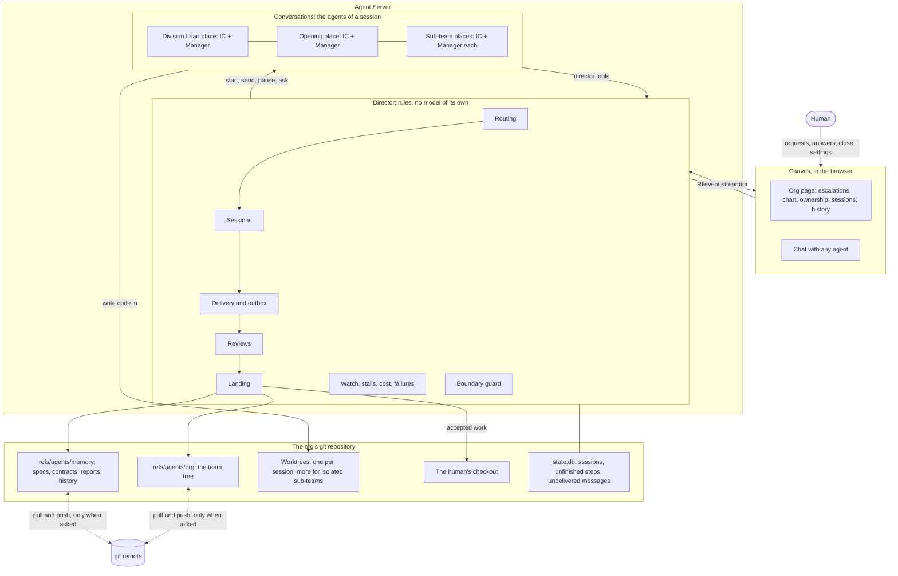

# How the director works

A reader's overview: the parts, and who talks to whom. How to run it is in
[README.md](README.md); the rules the code keeps to are in
[AGENTS.md](AGENTS.md).

## What it is

- **The director runs coding agents as an organisation:** a tree of teams,
  one per folder of a git repository.
- **It is code with fixed rules, not an agent.** It lives in the Agent
  Server under `/api/director`. It starts agents, carries their messages,
  holds each team to its folder and merges accepted work.
- **Agents are ordinary conversations** of the server: on a model the
  server calls, or Claude Code or Codex over ACP.
- **Canvas is the page:** an org page and the agents' chats.

## The system

## The pieces

- **Org tree.** The teams, each with a folder, a boundary, a spec, contracts
  and records. A team of the tree is a reference only: it has no agents.
- **Session.** One request of the human and all work done for it. Only
  sessions have agents. A session is kept on the machine and never pushed.
- **Place.** A session's own copy of a team, with its agents, status,
  review, escalations and pending split.
- **IC.** The agent that does a team's work, writes its spec, proposes
  sub-teams and reviews the teams directly below.
- **Manager.** One per team, derived from its IC. It writes no files: it
  approves, declines and prunes teams.
- **Type.** The team's template, a YAML file. It names the team's members
  and the tools each has, and says what they are told. The types shipped
  with the director name an IC and a Manager, as described here; whom the
  director turns to (who reviews, who approves) is found by the tool a
  member has, not by its name.
- **Division Lead place.** One more place above the place a session was
  opened at. Its IC reviews the session's code and specs; its Manager
  settles where the session's teams and contracts meet the org's.
- **Team memory.** `spec.md` (the inside of one folder), `contracts.md`
  (what teams promise each other), reports per agent, the record of the
  teams below, and the records of removed teams.

## A request, end to end

1. **The human writes a request.** The first one starts the org and its
   first session. Every later one opens a session of its own.
2. **Routing.** The request goes to the team it names, or to the lowest team
   the director is sure it concerns: the file paths the text names, and a
   model asked twice with the teams in opposite order. Any doubt moves the
   choice up, never sideways. A team that gets a request that is not its own
   hands it to the IC above.
3. **The session opens** in a git worktree of its own, and the IC of its
   opening place starts with the request.
4. **Split, if the IC wants one.** It proposes sub-teams (`propose_teams`);
   its Manager approves or declines (`approve_teams`, `decline_teams`).
   Setting a team up starts nothing: its IC starts with the first message
   sent to it (`msg_team`).
5. **Work.** Each IC writes only inside its folder. A guard on every file
   tool, a sandboxed shell and a scoped `git` hold it there.
6. **Submit.** `submit_review` rests the IC. The director asks that IC, on a
   copy of its conversation, for a write-up, and sends that account to the
   IC above with the code review instructions.
7. **Review.** The IC above decides with `review_team`: accept, which merges
   the work into the checkout above, or reject with findings, which sends it
   back. A team that changed nothing itself, with all its sub-teams
   accepted, goes up without a review.
8. **The session's review.** The Division Lead IC accepts the code and
   specs, in the order sessions submitted. Where the work meets what was
   accepted meanwhile, the reviewer reconciles it, or finishes a merge the
   director laid out.
9. **Landing, in two parts.** Code, specs and reports go into the human's
   checkout and team memory. Teams and contracts follow once the Division
   Lead Manager has settled what conflicts (`settle_teams`) and earlier
   sessions have landed theirs.
10. **After.** The session stays open for more requests. Only the human
    closes it.

## Who talks to whom

| From, to | How | For |
|---|---|---|
| Human to the org | First message of a chat, or the org page | A new request, or more in a session |
| Human to an agent | Its chat | Direct words, delivered at once |
| IC to its Manager | `msg_manager`, `propose_teams` | Discussion, proposed sub-teams |
| Manager to its IC, or an IC below | `msg_ic` | Guidance, explaining a change |
| Manager to teams below | `approve_teams`, `decline_teams`, `prune_team` | The shape of the teams |
| IC to an IC below | `msg_team`, `stop_team`, `review_team` | Tasks, a last-resort stop, verdicts |
| IC to the IC above | `submit_review`, `raise_escalation` | Never a direct message |
| Any agent, up its own line | `raise_escalation`, `resolve_escalation` | IC to IC, Manager to Manager, one place at a time, ending at the human |
| IC or Manager to team memory | `report`, `write_spec`, `hand_over` | Decisions, specs, what a removed team left |
| IC to its sub-teams' contracts | `write_contracts` | What the sub-teams must keep between them; what accepted work establishes for every team below; a correction |
| Director to an agent | Messages, with context updates attached | Notices. A change of context never wakes anyone by itself |
| Director to a model | A side question, or a copy of an agent's conversation | Titles and routing; write-ups and stall questions |

One team's IC never asks a team beside it. It escalates to the IC above,
which owns the contracts between its teams.

## What the director does unasked

- **Status** is worked out, never declared: blocked, working, done, idle or
  lost.
- **A failed agent** is told to the IC above, or to the human where no IC
  works above. The human's answer runs it again.
- **A stalled team** is told the same way (below).
- **A Manager is woken** to look at its teams every 5 reviews its IC
  accepted, and every 3 setbacks of one team below.
- **Cost** is counted about once a minute. At the session's limit the
  session rests and the human is asked.
- **A removed team** is archived, and the IC above gets a separate
  hand-over conversation to pass on what it left.
- **A restart** loses nothing: unfinished steps and undelivered messages are
  kept, the org loads paused, and a resume carries on.

## Questions that come up

### Can a review still reject work, and what ends a loop?

`review_team` accepts or rejects, and a reject must say what has to change.
There is no limit on rejections, by decision. What ends a loop:

- **The Manager above is woken** after every 3 times one piece of work is
  sent back, with the team's record. It can write to the IC or prune the
  team.
- **The reviewing IC can stop the team** (`stop_team`), or propose another
  team for the same folder.
- **The session's cost limit** rests the whole session and asks the human.
- **The human** can write to either agent or close the session. The human
  cannot stop, prune, replace or split a team.

### What is a stall question?

A team stalls when it owes work and shows no progress for
`soft_check_in_minutes` (default 120): no commit in its folder, nothing
submitted, no escalation. Before the IC above is told, the director asks the
stalled team's own IC, on a copy of its conversation so that nothing is
added to it: what it is working on, what has kept it from committing or
submitting, and what it needs. The answer goes into the notice. It is not
asked while that IC is in a turn.

### What is a check-in?

A team that commits steadily never stalls, however long it takes. So the IC
above is also told how a team that has not submitted stands every
`hard_check_in_minutes` (default 360), whether or not it shows progress: whether
its IC is in a turn, its last commit, and where to look. The time is counted
from when that IC last turned to the team (gave it its task, wrote to it,
sent its work back) or was last told of it, and is never shorter than
`soft_check_in_minutes`. A stall notice counts as being told, so a team is
never told of twice at once, and teams due at the same time are told of in
one message. The team itself is not asked or disturbed.

### What can the human do?

Send requests, write to any agent, answer escalations, edit a team's file
while its agents are idle, change settings, pause and resume, pull and push
the org, start a lost place again, and close a session.
